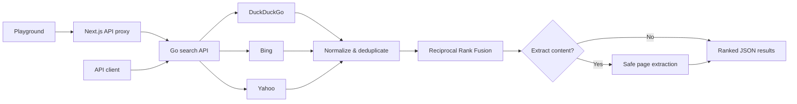

<div align="center">

# Plewtus

### Federated search for AI agents

Search DuckDuckGo, Bing, and Yahoo in parallel. Deduplicate destinations, rank with Reciprocal Rank Fusion, and optionally extract pages as Markdown.

<p>
  
  
  
</p>

</div>

## How it works



## Run it

Requires Docker Desktop and Docker Compose.

```bash
cp .env.example .env
```

Set `PLEWTUS_API_KEY` in `.env` to a long random value, then start the app:

```bash
docker compose up --build -d
```

| Service | Local URL |
| --- | --- |
| Playground | [http://localhost:3000](http://localhost:3000) |
| Search API | `http://localhost:8080` |
| Health check | `http://localhost:8080/healthz` |

## Search with Markdown extraction

Load the local API key and call the backend directly:

```bash
set -a && . ./.env && set +a

curl -sS http://localhost:8080/search \
  -H 'Content-Type: application/json' \
  -H "Authorization: Bearer $PLEWTUS_API_KEY" \
  -d '{
    "query": "golang concurrency patterns",
    "limit": 3,
    "extract": {
      "enabled": true,
      "mode": "markdown",
      "max_pages": 2
    }
  }'
```

Extracted page content is returned in `results[].content.markdown`. Other modes: `highlights`, `text`, and `metadata`.

## Deploy

- **Backend · Render:** create a Docker web service from `backend/Dockerfile`. Set `PLEWTUS_AUTH_REQUIRED=true` and `PLEWTUS_API_KEYS=<key>:pro`.
- **Frontend · Vercel:** import the repo with root directory `frontend`. Set `PLEWTUS_BACKEND_URL` to the Render service URL and `PLEWTUS_API_KEY` to the matching key (without `:pro`). Keep the key server-side; never prefix it with `NEXT_PUBLIC_`.

Render’s free backend sleeps when idle, so its first request after a quiet period may be slow.

## Interfaces & docs

- `POST /search` — JSON search API
- `GET /healthz` — health probe
- MCP over stdio — `cd backend && go run ./cmd/plewtus mcp`
- [API reference](backend/docs/API.md) · [MCP setup](backend/docs/MCP.md) · [OpenAPI spec](backend/docs/openapi.yaml)

## Local development

```bash
(cd backend && go test ./...)
(cd frontend && npm ci && npm run dev)
```

To stop the Docker stack: `docker compose down`.
