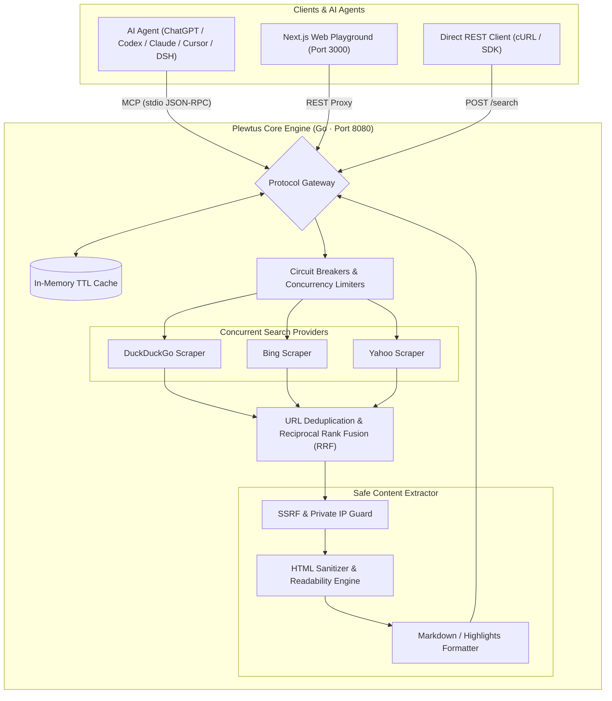

<div align="center">

# Plewtus

### Federated Metasearch & Extraction Engine for AI Agents

**Zero search API keys required.** Query multiple search engines concurrently, deduplicate URLs, rank results with Reciprocal Rank Fusion (RRF), safely extract full page content into LLM-ready Markdown, and connect directly to AI agents via the Model Context Protocol (MCP).

<p align="center">
  
  
  
  
  
  
</p>

[Quickstart](#quickstart) • [Architecture](#architecture) • [MCP Integration](#model-context-protocol-mcp-integration) • [Search & Extraction](#search--page-extraction) • [Configuration](#configuration-reference)

</div>

---

## Key Capabilities

- **Zero Search API Keys Required** — Built-in resilient scrapers for DuckDuckGo, Bing, and Yahoo with automatic query escaping and anti-bot mitigation.
- **Sub-Second Concurrent Search** — Fan-out queries across all providers in parallel with per-engine timeouts, circuit breakers, and graceful fallback.
- **Reciprocal Rank Fusion (RRF)** — Merges multi-engine rankings into a consensus score ($k=60$) alongside domain-level canonical deduplication.
- **On-The-Fly Web Extraction** — Automatically strips boilerplate, adverts, and scripts, converting target web pages into clean Markdown, Highlights, or plain text.
- **Native Model Context Protocol (MCP)** — Seamless stdio MCP integration with ChatGPT Desktop, OpenAI Codex CLI, Claude Desktop, Cursor, and local LLM harnesses (DeepSeek Harness, Ollama).
- **Production-Grade Reliability** — Full SSRF protection (loopback and private IP blocking), thread-safe in-memory TTL caching, token bucket rate limits, and zero external database dependencies.

---

## Architecture



---

## Quickstart

### Option 1: Docker Compose (Recommended)

Run the full stack (Go Search API + Next.js Playground) with a single command:

```bash
# 1. Clone repository
git clone https://github.com/your-username/PlewtusV1.git
cd PlewtusV1

# 2. Configure environment
cp .env.example .env

# 3. Start services
docker compose up --build -d
```

| Service | Address | Description |
| :--- | :--- | :--- |
| **Playground UI** | [http://localhost:3000](http://localhost:3000) | Interactive web interface with live JSON inspector |
| **Search API** | [http://localhost:8080](http://localhost:8080) | High-performance Go REST API |
| **Health Check** | [http://localhost:8080/healthz](http://localhost:8080/healthz) | Liveness and readiness probe |

---

### Option 2: Native Binary / Local Development

```bash
# Run backend
cd backend
go run ./cmd/plewtus serve

# In another terminal, run frontend
cd frontend
npm install
npm run dev
```

---

## Model Context Protocol (MCP) Integration

Plewtus includes a native [Model Context Protocol](https://modelcontextprotocol.io/) stdio server, turning Plewtus into a private real-time search engine for any LLM.

### Compile the MCP Binary
```bash
cd backend
go build -o bin/plewtus-mcp ./cmd/plewtus-mcp
```

### 1. ChatGPT Desktop (GUI)
Under **Settings → MCP Servers → Connect to a custom MCP**:
- **Name:** `plewtus`
- **Type:** `STDIO`
- **Command to launch:** `/absolute/path/to/PlewtusV1/backend/bin/plewtus-mcp`
- **Working directory:** `/absolute/path/to/PlewtusV1`

### 2. OpenAI Codex / ChatGPT CLI (`~/.codex/config.toml`)
Add to `~/.codex/config.toml`:
```toml
[mcp_servers.plewtus]
enabled = true
command = "/absolute/path/to/PlewtusV1/backend/bin/plewtus-mcp"
cwd = "/absolute/path/to/PlewtusV1"

[mcp_servers.plewtus.env]
PLEWTUS_CACHE_ENABLED = "true"
PLEWTUS_CACHE_TTL_SECONDS = "600"
```

### 3. Claude Desktop
Add to your `claude_desktop_config.json`:
```json
{
  "mcpServers": {
    "plewtus": {
      "command": "/absolute/path/to/PlewtusV1/backend/bin/plewtus-mcp",
      "env": {
        "PLEWTUS_CACHE_ENABLED": "true",
        "PLEWTUS_CACHE_TTL_SECONDS": "600"
      }
    }
  }
}
```

### 4. Cursor / VS Code
Add to your workspace `.cursor/mcp.json` or MCP Extension config:
```json
{
  "mcpServers": {
    "plewtus": {
      "command": "/absolute/path/to/PlewtusV1/backend/bin/plewtus-mcp"
    }
  }
}
```

### 5. DeepSeek Harness (`cordis.patch.yml`)
```yaml
- id: mcp-plewtus
  name: "@deepseek-ai/dsh-mcp-client"
  config:
    serverName: plewtus
    transport: stdio
    command: "/absolute/path/to/PlewtusV1/backend/bin/plewtus-mcp"
```

### Available MCP Tools
- **`search`**: Multi-engine search with freshness filtering, domain whitelisting/blacklisting, and optional on-the-fly webpage extraction (`markdown`, `highlights`, `text`).
- **`extract`**: Direct SSRF-safe content extraction from any list of target URLs.

---

## Search & Page Extraction

Execute a search with automated Markdown extraction:

```bash
curl -sS http://localhost:8080/search \
  -H 'Content-Type: application/json' \
  -H "Authorization: Bearer $PLEWTUS_API_KEY" \
  -d '{
    "query": "golang concurrency patterns",
    "limit": 3,
    "extract": {
      "enabled": true,
      "mode": "markdown",
      "max_pages": 2
    }
  }'
```

### Response Preview

```json
{
  "query": "golang concurrency patterns",
  "results": [
    {
      "id": "res_1",
      "title": "Go Concurrency Patterns: Pipelines and cancellation",
      "url": "https://go.dev/blog/pipelines",
      "snippet": "Go's concurrency primitives make it easy to construct streaming data pipelines...",
      "score": 0.032787,
      "ranking_score": 0.9412,
      "engines": [
        {"name": "duckduckgo", "position": 1},
        {"name": "yahoo", "position": 1}
      ],
      "content": {
        "markdown": "# Go Concurrency Patterns: Pipelines\n\nGo provides primitives that facilitate building concurrent pipelines...",
        "author": "Sameer Ajmani",
        "extracted_at": "2026-11-06T16:30:14Z"
      }
    }
  ],
  "metadata": {
    "took_ms": 1820,
    "providers": {
      "queried": ["duckduckgo", "bing", "yahoo"],
      "successful": ["bing", "duckduckgo", "yahoo"]
    }
  }
}
```

### Extraction Modes

| Mode | Output Format | Recommended Use Case |
| :--- | :--- | :--- |
| `markdown` | Clean GitHub Flavored Markdown | Deep synthesis and technical documentation |
| `highlights` | High-signal excerpt sentences | Fast fact verification and lightweight context |
| `text` | Cleaned plain readable text | General classification or summarization |
| `metadata` | Title, description, author, publication date | Source vetting and cataloging |

---

## Configuration Reference

Plewtus is configured via environment variables:

| Variable | Default | Description |
| :--- | :--- | :--- |
| `PORT` | `8080` | HTTP listening port for the REST API |
| `PLEWTUS_AUTH_REQUIRED` | `false` | When `true`, rejects requests lacking a valid Bearer token |
| `PLEWTUS_API_KEYS` | `""` | Comma-delimited list of authorized keys (e.g. `key1:free,key2:pro`) |
| `PLEWTUS_PROVIDERS` | `duckduckgo,bing,yahoo` | Default providers queried per search |
| `PLEWTUS_CACHE_ENABLED` | `true` | Enables in-memory LRU search cache |
| `PLEWTUS_CACHE_TTL_SECONDS` | `300` | Search result cache expiration in seconds |
| `PLEWTUS_DEFAULT_TIMEOUT` | `5s` | Max duration per upstream provider request |
| `PLEWTUS_RATE_LIMIT_FREE` | `10` | Free tier requests allowed per minute |
| `PLEWTUS_QUOTA_FREE` | `100` | Free tier requests allowed per day |

---

## Repository Structure

```text
PlewtusV1/
├── backend/
│   ├── cmd/
│   │   ├── plewtus/         # Unified server & CLI binary
│   │   └── plewtus-mcp/     # Dedicated stdio MCP server binary
│   ├── internal/
│   │   ├── cache/           # Thread-safe in-memory TTL caching
│   │   ├── extractor/       # HTML parser, readability & markdown formatter
│   │   ├── mcp/             # Model Context Protocol JSON-RPC 2.0 handler
│   │   ├── orchestrator/    # Concurrent execution & RRF rank fusion
│   │   ├── provider/        # DuckDuckGo, Bing, and Yahoo scrapers
│   │   └── reliability/     # Circuit breakers, retries, and SSRF guards
│   └── docs/                # OpenAPI specification and API manuals
├── frontend/
│   ├── src/app/             # Next.js 16 App Router UI & API proxy
│   └── src/components/      # Playground, filters, and JSON viewer
└── docker-compose.yml       # Production-ready container orchestration
```

---

## License

Distributed under the Apache License 2.0. See [LICENSE](LICENSE) for more information.
